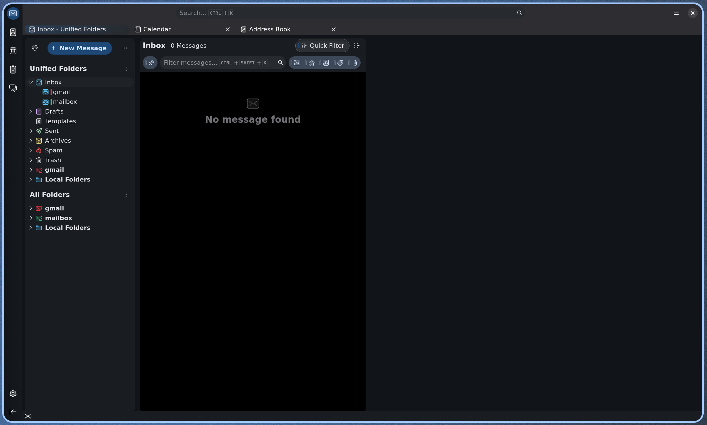
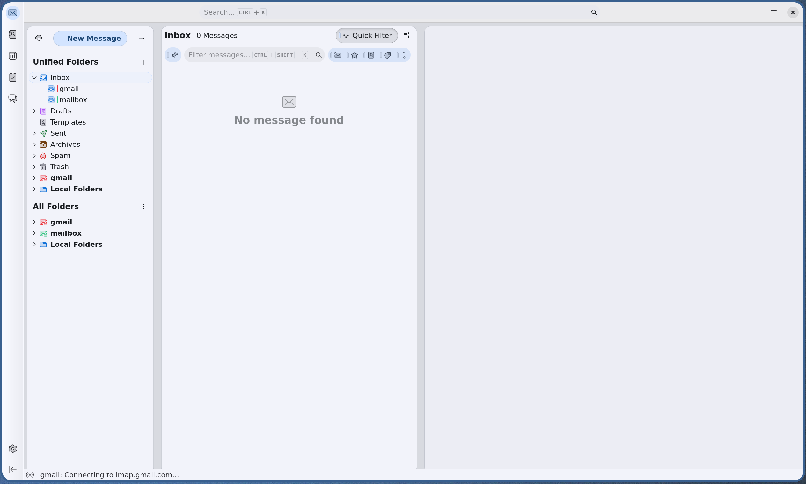

# Betterbird

Keeps [Betterbird](https://www.betterbird.eu/) in sync with the Noctalia palette.





## What it themes

Noctalia renders its palette into Betterbird's chrome through `userChrome.css` and `userContent.css`.
The template overrides Betterbird's layout variables, which cover the toolbars,
folder pane, message list, message header and cards in one place:

- backgrounds, text and separators (`--layout-background-*`, `--layout-color-*`,
  `--layout-border-*`)
- selected folder and message rows (`--selected-item-*`)
- the accent color (`--color-accent-primary`)
- full calendar views, address book, chat, message viewer, and compose window

It also trims the chrome for tiling setups: the classic menu bar is hidden and
the tab bar, unified toolbar and list rows are made more compact.

On top of the palette it applies Material 3 shape and surfaces: pill buttons and
inputs, 12dp cards and panels, filled tonal buttons (`secondary_container`) and
message cards matching the unified background. The Spaces rail gets a circular
active indicator behind the icon, the tab strip softer corners, and the search
field a filled container.

## Setup

1. Enable **Betterbird** in Noctalia under *Settings -> Templates* (community
   templates), or in `settings.toml`:

   ```toml
   [theme.templates]
   community_ids = ["betterbird"]
   ```

2. Apply a theme (change the wallpaper/palette, or re-apply the current one).
   `apply.sh` writes the rendered file and wires it into every profile.

3. Restart Betterbird once. `userChrome.css` and `userContent.css` are only read on startup.

## How the wiring works

`apply.sh` looks for `prefs.js` in Betterbird and Thunderbird profiles (under `~/.betterbird`, `~/.thunderbird`,
Flatpak and Snap paths). It automatically identifies Betterbird-specific profiles via `compatibility.ini` and:

- prepends `@import "<cache>/betterbird/noctalia.css";` to `chrome/userChrome.css` and `chrome/userContent.css`
  (creating the directory and files if needed),
- ensures `user_pref("toolkit.legacyUserProfileCustomizations.stylesheets", true);` in `user.js`.

Both steps are idempotent: re-applying never duplicates a line.

## Uninstall

Remove the import lines from `chrome/userChrome.css` and `chrome/userContent.css`, and disable the template in Noctalia.
