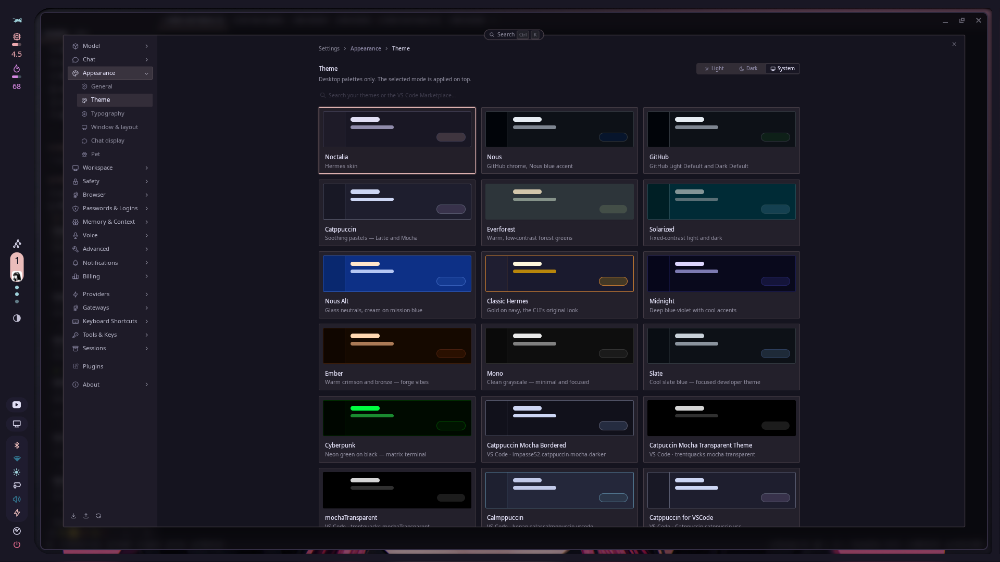
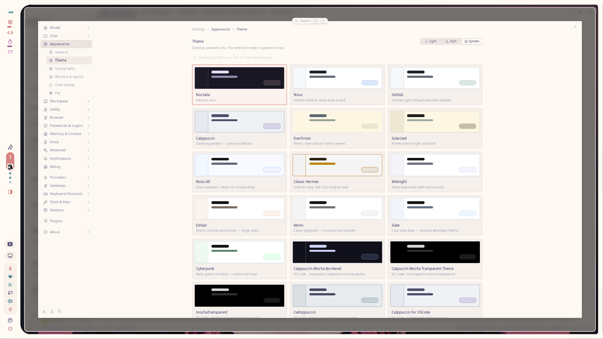

# Hermes Agent



Themes the Hermes Agent CLI, TUI and desktop app from the Noctalia palette.

Tested with Hermes Agent v0.22.2 (2026.9.24).

## What it themes

Hermes has two independent theme layers, and this template drives the one that
can follow a changing palette:

| Layer | Where | Updates by itself? |
|---|---|---|
| Desktop user theme (marketplace / VS Code JSON) | the Electron renderer's `localStorage` | no — frozen at import time |
| **Backend skin** (`<hermes-home>/skins/<name>.yaml`) | a file on disk, read by the gateway | **yes** |

This template renders a **backend skin**. The gateway watches the skin file's
mtime, so a palette change repaints every Hermes surface within about a
second — no restart, no re-import.

The rendered skin carries two things:

- `colors:` — the CLI/TUI palette, and the seed the desktop app derives its own
  palette from.
- `customCSS:` — the desktop app's exact CSS custom properties, so the window
  chrome, sidebar, popovers and borders follow the palette precisely.



## Prerequisites

- Noctalia v5+
- [Hermes Agent](https://github.com/NousResearch/hermes-agent) installed, with
  the `hermes` CLI on `PATH` (or at `~/.local/bin/hermes`)
- At least one Hermes home: the default home (`~/.hermes`) or a profile
  (`~/.hermes/profiles/<name>/`)

## Setup

Enable **Hermes Agent** in Noctalia under Settings → Templates. There is no
further manual setup: the template's hook writes the skin into every Hermes
home it finds and selects it.

To opt a specific home out, create the marker file
`<hermes-home>/.noctalia-hermes-sync-off`. The hook skips any home that has
it.

## Generated config paths

| Path | What it holds |
|---|---|
| `$XDG_STATE_HOME/noctalia/hermes/hermes-skin.yaml` | the rendered skin (Noctalia writes it) |
| `<hermes-home>/skins/noctalia.yaml` | the copy Hermes reads |
| `<hermes-home>/config.yaml` | `display.skin: noctalia` |

The default home (`~/.hermes`) and every profile are handled.

## How changes take effect

Every palette change re-renders the skin and re-runs the hook. The hook writes
the skin file only when its content actually changed, and it selects the skin
only when it is not already selected — so a palette change repaints the
running app without restarting anything.

The **classic CLI** is the exception: it reads the skin at start-up and does
not watch for changes. Start a new session, or run `/skin noctalia` in the
running one. The TUI and the desktop app do repaint live.

## Hook side effects

`apply.sh` runs on every palette change and:

1. copies the rendered skin into each Hermes home's `skins/` directory,
   using a temp file plus a rename, so an interrupted run never leaves a
   truncated YAML behind;
2. runs `hermes config set display.skin noctalia` with `HERMES_HOME` pointed at
   that home — the safe writer, never a hand-edit of `config.yaml`;
3. refuses to follow a symlink out of the chosen home.

Homes run in parallel, each bounded by a 90-second timeout, so one slow
profile cannot hold up the rest.

It downloads nothing and executes nothing it did not ship in this directory.
Running it twice is a no-op.

The generated skin file is replaced on every palette update, so back up any
customizations you make there.

## Uninstall

Disable the template in Noctalia, then:

```sh
hermes config set display.skin default
rm -f ~/.hermes/skins/noctalia.yaml ~/.hermes/profiles/*/skins/noctalia.yaml
```

A theme installed from the VS Code Marketplace is left untouched — it is a
separate layer and keeps working.
