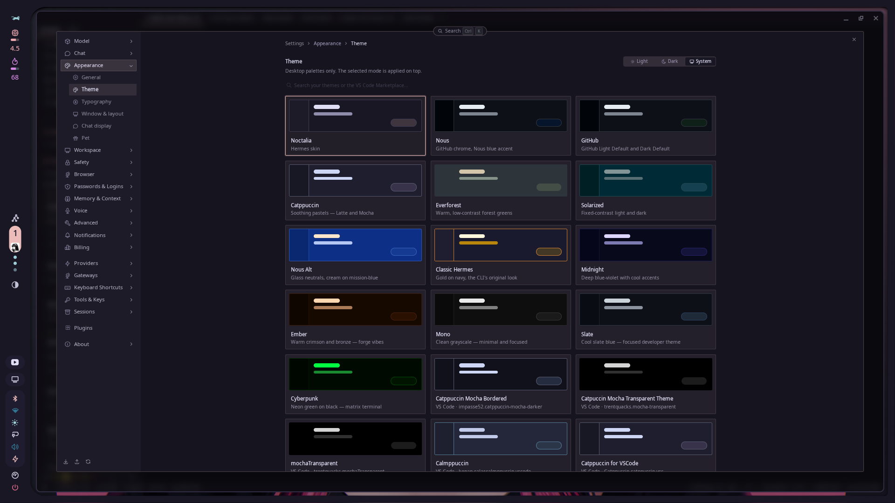
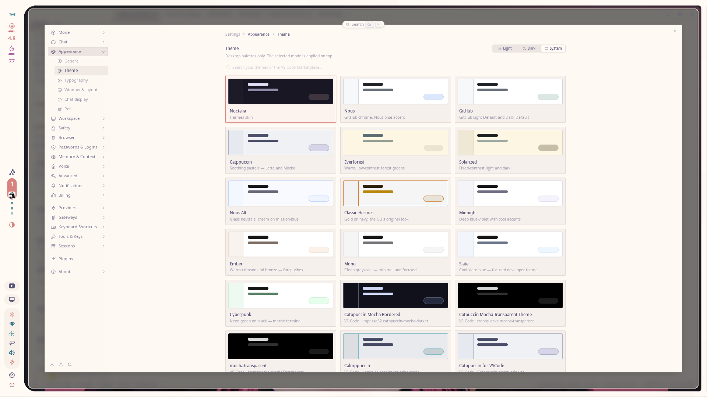

# Hermes Agent



Themes the Hermes Agent CLI, TUI and desktop app from the Noctalia palette.

Tested with Hermes Agent v0.22.2 (2026.9.24).

## What it themes

Hermes has two theme layers. This template drives the one that can follow a changing palette:

| Layer | Where | Updates by itself |
|---|---|---|
| Desktop user theme (marketplace / VS Code JSON) | the Electron renderer's `localStorage` | no, frozen at import |
| Backend skin (`<hermes-home>/skins/<name>.yaml`) | a file on disk, read by the gateway | yes |

The gateway watches the skin file's mtime, so a palette change repaints every Hermes surface in
about a second, without restarting or re-importing anything.

The rendered skin carries `colors:` (the CLI/TUI palette, and the seed the desktop app derives its
own from) and `customCSS:` (the desktop app's CSS custom properties, so window chrome, sidebar,
popovers and borders follow the palette).



## Prerequisites

- Noctalia v5+
- [Hermes Agent](https://github.com/NousResearch/hermes-agent) installed, with the `hermes` CLI on
  `PATH` or at `~/.local/bin/hermes`
- At least one Hermes home: `~/.hermes` or `~/.hermes/profiles/<name>/`
- `realpath`, `timeout`, `cmp` and `awk` (coreutils; present on any normal Linux install)

## Setup

Enable **Hermes Agent** in Noctalia under Settings → Templates. No further manual setup is
needed: the hook writes the skin into every Hermes home it finds and selects it.

To skip a specific home, create `<hermes-home>/.noctalia-hermes-sync-off`; the hook ignores any
home that has it.

## Generated config paths

| Path | What it holds |
|---|---|
| `$XDG_STATE_HOME/noctalia/hermes/hermes-skin.yaml` | the rendered skin (Noctalia writes it) |
| `<hermes-home>/skins/noctalia.yaml` | the copy Hermes reads |
| `<hermes-home>/config.yaml` | `display.skin: noctalia` |

The default home and every profile are handled.

## How changes take effect

Every palette change re-renders the skin and re-runs the hook. The hook writes the skin only when
its content changed, and selects it only when it is not already selected, so a palette change
repaints the running app without restarting it.

The classic CLI is the exception: it reads the skin at start-up. Start a new session, or run
`/skin noctalia` in the running one. The TUI and the desktop app repaint live.

## Hook side effects

`apply.sh` runs on every palette change and:

1. copies the rendered skin into each home's `skins/`, through a temp file and a rename, so an
   interrupted run never leaves a truncated YAML behind;
2. resolves the destination's directory with `realpath` and refuses anything that lands outside
   the profile home, which catches a `skins/` symlink pointing elsewhere;
3. runs `hermes config set display.skin noctalia` with `HERMES_HOME` set to that home, so the
   config goes through the CLI's writer instead of a hand edit;
4. runs with `set -euo pipefail`, so a failed `chmod`, `mv` or `hermes config set` fails the hook
   instead of passing silently.

Homes run in parallel, each bounded by a 90-second timeout. The hook downloads nothing and
executes nothing it did not ship here. Running it twice is a no-op.

The generated skin is replaced on every palette update, so back up any customization you make in
that file.

## Uninstall

Disable the template in Noctalia, then:

```sh
hermes config set display.skin default
rm -f ~/.hermes/skins/noctalia.yaml ~/.hermes/profiles/*/skins/noctalia.yaml
```

A theme installed from the VS Code Marketplace is a separate layer and keeps working.
