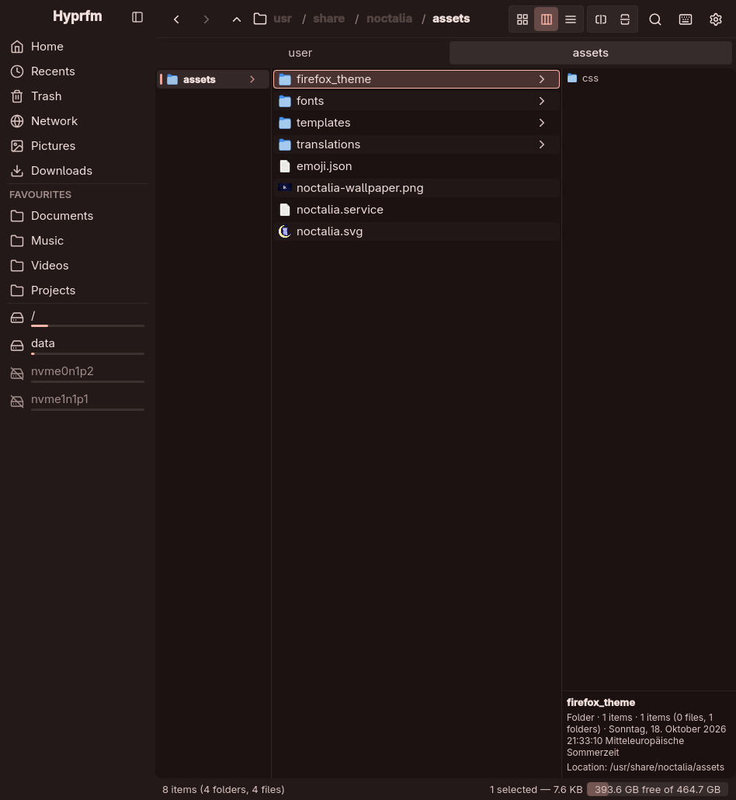
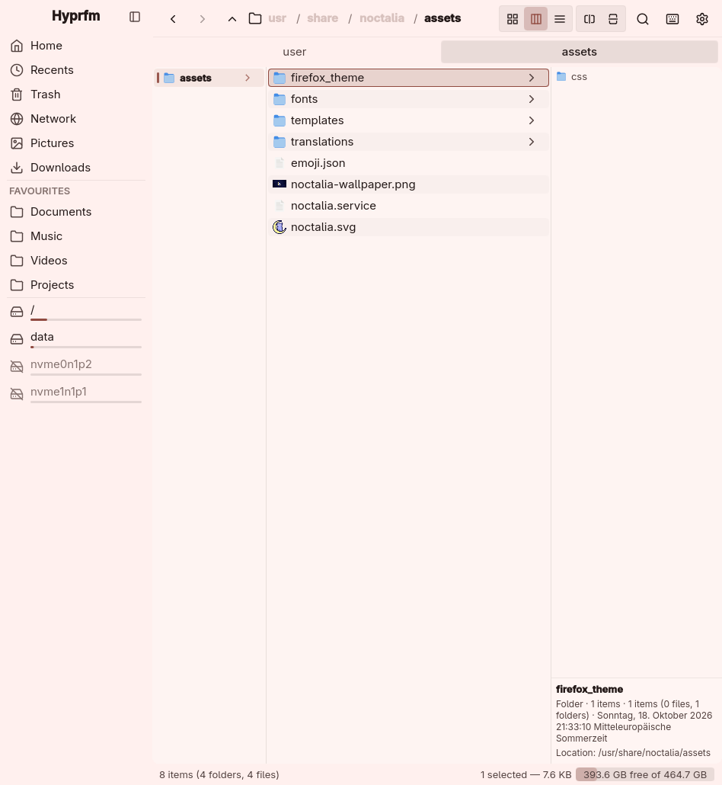

# HyprFM

Keeps [HyprFM](https://github.com/soyeb-jim285/hyprfm), a Qt6/QML file manager for Wayland, in sync with the
Noctalia palette.





## What it themes

Noctalia renders a HyprFM theme file, `~/.config/hyprfm/themes/noctalia.toml`, with:

- the twelve UI colors HyprFM themes are made of:

  | HyprFM key | Used for | Noctalia token |
  | --- | --- | --- |
  | `base` | file view background | `surface` |
  | `mantle` | toolbar, sidebar, dialogs | `surface_container_low` |
  | `crust` | deepest layer | `surface_container` |
  | `surface` | cards, inputs, hovered rows | `surface_container_highest` |
  | `overlay` | borders, separators | `outline_variant` |
  | `text` | primary text | `on_surface` |
  | `subtext` | secondary text | `on_surface_variant` |
  | `muted` | icons, disabled text | `outline` |
  | `accent` | selection, focus ring, links | `primary` |
  | `success` | completed operations | `secondary` |
  | `warning` | warnings | `tertiary` |
  | `error` | errors, destructive actions | `error` |

- the 16 ANSI colors of the built-in terminal (F4), from Noctalia's `terminal_*` tokens.

File and folder icons come from the icon theme and are not touched.

## Prerequisites

- HyprFM with user themes in `~/.config/hyprfm/themes` (tested with 0.7.0).
- HyprFM has been started once, so `~/.config/hyprfm/config.toml` exists.

## Setup

1. Enable **HyprFM** in Noctalia under *Settings -> Templates* (community templates), or in `settings.toml`:

   ```toml
   [theme.templates]
   community_ids = ["hyprfm"]
   ```

2. Apply a theme (change the wallpaper/palette, or re-apply the current one).

No manual setup in HyprFM is needed and nothing has to be restarted: HyprFM watches its config and the active
theme file, so open windows recolor as soon as Noctalia writes them.

## What the hook does

`apply.sh` sets `theme = "noctalia"` under `[general]` in `~/.config/hyprfm/config.toml`, replacing whatever theme
was selected there. Every other line is left as it is, and a config that already selects `noctalia` is not
rewritten. It exits with an error when `config.toml` does not exist instead of creating one.

Two things to know:

- The Dark Mode switch in HyprFM's settings flips `theme` to HyprFM's own `light_theme`/`dark_theme` pair. The
  next Noctalia theme change selects `noctalia` again; light and dark follow Noctalia's theme mode.
- With HyprFM's transparency enabled, the file view stays translucent; only its tint follows the palette.

## Uninstall

Disable the template in Noctalia (or remove it from `community_ids`). Noctalia runs `undo.sh`, which:

- removes the `theme = "noctalia"` line from `config.toml` (a different theme selected in the meantime is kept),
- deletes `~/.config/hyprfm/themes/noctalia.toml`.

HyprFM then falls back to its `light_theme`/`dark_theme` pair. The theme that was selected before the template
was enabled is not restored; pick it again in HyprFM's settings.
