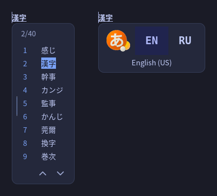
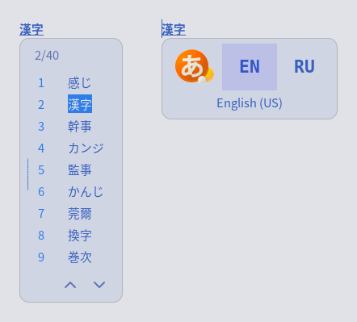

# IBus

Keeps the [IBus](https://github.com/ibus/ibus) input method panel, the candidate window, the engine switcher and the emoji picker in sync with the Noctalia palette.





## What it themes
Apart from color styling:
- The candidate window and the engine switcher are drawn as rounded panels that follow two Noctalia settings, `corner_radius_scale` sets the radius and `popup_borders` turns the border on or off.
- The emoji picker gets the same colors on the widget shapes of GTK's built-in Adwaita stylesheet, dark or light to match Noctalia's mode.
- ibus paints the highlighted candidate as a text background, so it stays a square box around the text. It also marks the selected engine in the switcher with a faint blue tint of its own, which no theme can recolor.

## Prerequisites

- IBus with its GTK 3 panel, `ibus-ui-gtk3`.
- `gsettings`, which ibus itself depends on.

## Setup

1. Enable **IBus** in Noctalia under *Settings -> Templates* (community templates), or in `settings.toml`:

   ```toml
   [theme.templates]
   community_ids = ["ibus"]
   ```

2. Apply a theme (change the wallpaper/palette, or re-apply the current one).

## What the hook does

`apply.sh` writes two keys of `org.freedesktop.ibus.panel`, the same settings as *Advanced -> Use custom theme* in `ibus-setup`:

- `custom-theme` = `'noctalia-ibus'`
- `use-custom-theme` = `false`, then `true`. ibus only re-applies its theme when one of these keys changes, so this toggle is what makes the running panel pick up new colors.

Two things worth noting:

- A custom theme you had picked in `ibus-setup` is replaced while the template is enabled.
- `noctalia-ibus` sits in `~/.local/share/themes`, so GTK theme pickers like nwg-look will also list it.

## Uninstall

Disable the template in Noctalia (or remove it from `community_ids`). Noctalia runs `undo.sh`, which:

- resets `custom-theme` and `use-custom-theme` to their defaults if ibus still points at `noctalia-ibus`, so the panel follows the system GTK theme again (a different custom theme picked in the meantime is kept),
- deletes `~/.local/share/themes/noctalia-ibus`.

A custom theme picked in `ibus-setup` before the template was enabled is not restored.

Tested with IBus 1.5.32 and GTK 3.24.52 on Niri.
