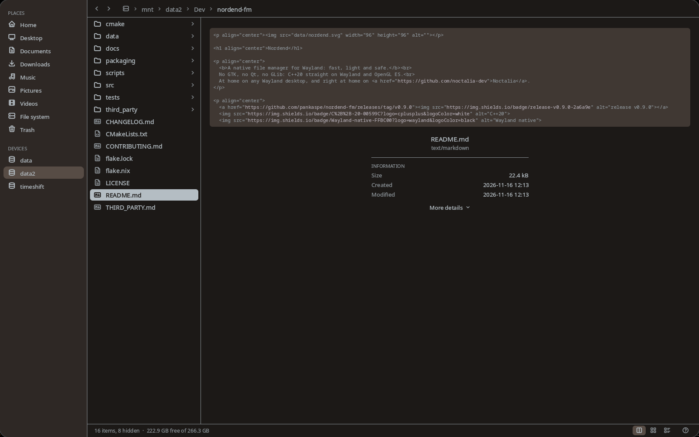
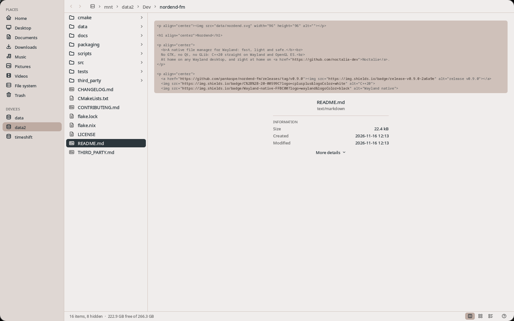

# Nordend

Themes [Nordend](https://github.com/pankaspe/nordend-fm), a native Wayland file manager, with the Noctalia palette.

## What is themed

The whole window: the header with the path, the sidebar, the file views, the info pane, Quick Look, the command palette,
menus, dialogs and selections. Nordend also tints its line icons with the palette and writes its own app icon in the
`primary` color. The template only writes the Material roles; Nordend decides where each one goes.

## Prerequisites

Nordend 0.1.0 or newer (tested with 0.9.5). Every release reads `colors.toml`.

## Setup

None. Enable Nordend in Settings -> Templates and apply a theme (re-applying the current one is enough).

## Output

`$XDG_CONFIG_HOME/nordend/colors.toml` (normally `~/.config/nordend/colors.toml`).

Nordend watches this file and recolors open windows as soon as Noctalia writes it, so nothing has to be restarted.
The file takes precedence over the colors Nordend would otherwise take from GTK's `gtk.css` or the desktop portal.

## Notes

- No hooks. Nordend's own `config.toml` is not touched.
- Noctalia overwrites the file on every theme change, so do not edit it by hand.
- The header follows `surface`, because the template does not set Nordend's optional `header` key.
- If you already render your own Nordend template to the same path as a user template, disable one of the two.
  Otherwise whichever runs last wins.
- Disabling the template leaves the last `colors.toml` in place. Delete it to go back to the GTK or desktop colors.
