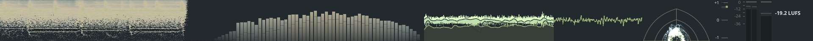
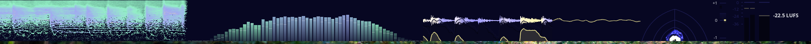

# OpenMeters

Themes [OpenMeters](https://github.com/httpsworldview/openmeters) using the
active Noctalia palette.

The template renders an OpenMeters theme file (background + per-visual
palette stops) from the Noctalia token map and writes it to
`$XDG_CONFIG_HOME/openmeters/themes/noctalia.json`, where OpenMeters picks it
up as the theme named `noctalia`. The post hook points
`$XDG_CONFIG_HOME/openmeters/settings.json` at it via the top-level `theme`
field.

Launch OpenMeters once before enabling the template so its configuration
directory and `settings.json` exist.

The hook requires `jq`.

OpenMeters loads the active theme at startup; switch the theme in OpenMeters
(Settings > Appearance) or set `theme` in `settings.json`, then restart the
application to pick the new file up. Theme changes also need a restart to
re-read the theme file.

The per-visual stop-to-token mapping is authored from Noctalia's Material
token set (background, surface, primary, error, outline, and the fixed/accent
roles). Adjust `openmeters.json` if a specific visual's mapping needs to
differ.

## Screenshots

## Undo

The post hook edits the theme selection in `settings.json`, so the template
ships an `undo_hook` that restores the previous selection from a state file and
removes it. Undo is a no-op when there is nothing to revert.
