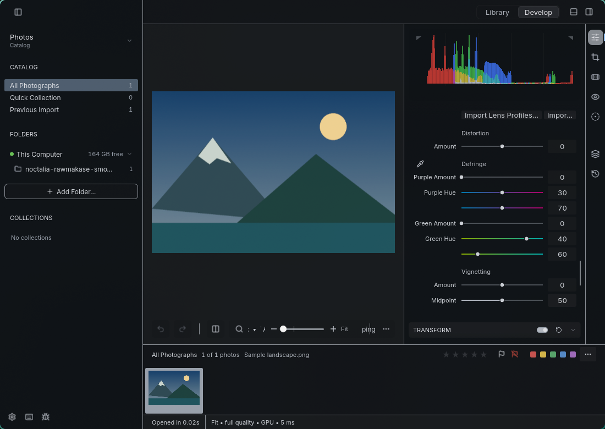
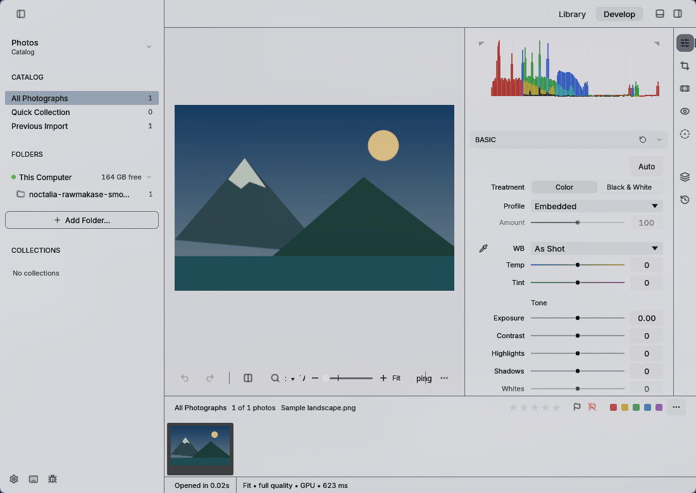

# RAWmakase

Themes RAWmakase's window, panels, controls, text and accent colors using its native palette files. Both dark and light palettes are supported. This changes the interface, not image processing or exported photos.

Tested with RAWmakase 0.4.10 and Noctalia 5.2.1 on Linux.

## Setup

1. Enable the RAWmakase community template in Noctalia's template settings.
2. Apply your Noctalia theme to generate the palette.
3. In RAWmakase, open Preferences → Display and select **Noctalia** in the Theme dropdown.

RAWmakase watches its themes folder and reloads the selected palette when Noctalia updates it. No restart or hook is needed.

## Generated file

`$XDG_DATA_HOME/rawmakase/themes/Noctalia.json`, normally `~/.local/share/rawmakase/themes/Noctalia.json`.

The file is overwritten on each theme application. The template does not edit RAWmakase's session or catalog. Disabling it stops updates but leaves the generated palette and the app's theme selection in place. Select another theme in RAWmakase to stop using it.

For installations with a custom `RAWMAKASE_DATA_DIR`, use a Noctalia user template with an output path pointing to that directory's `themes/Noctalia.json` instead.

## Screenshots

Synthetic sample image, with the same Noctalia palette rendered in each mode.

### Dark

### Light

