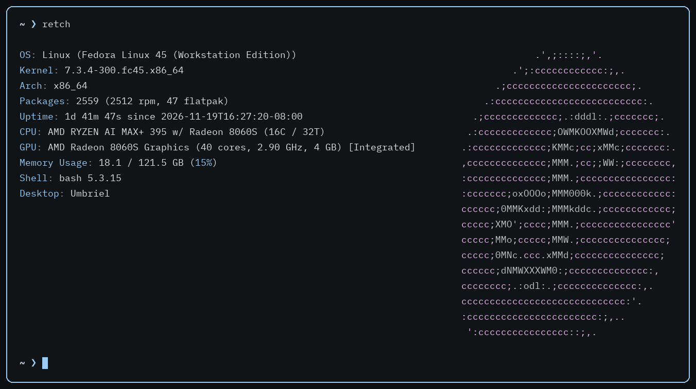
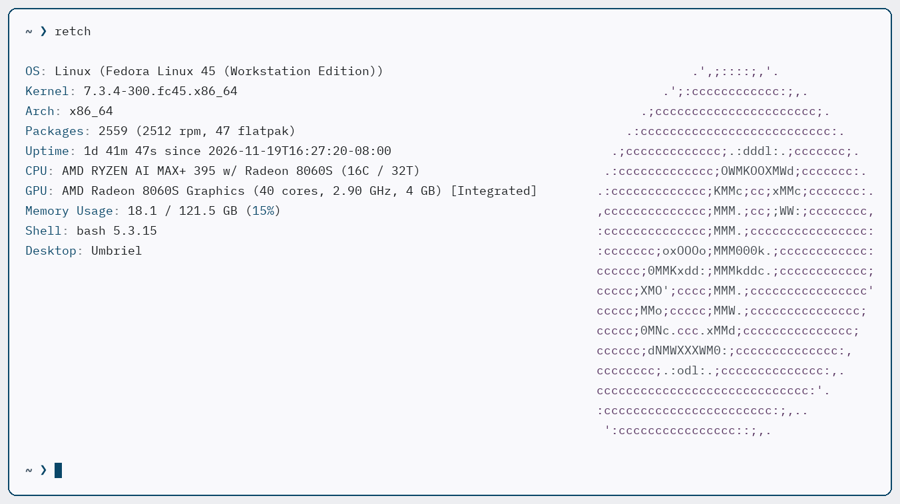

# retch

Themes [retch](https://github.com/l1a/retch), a fast concurrent system information fetcher written in Rust, with
colors from the Noctalia palette.





## What it themes

Noctalia renders a theme fragment at `$XDG_CONFIG_HOME/retch/themes/noctalia.toml` (`~/.config/retch/themes/noctalia.toml`
by default) setting `theme = "custom"` and `[custom_theme]`:

| `retch` key | Role | Noctalia token |
| --- | --- | --- |
| `label_color` | field labels (`OS`, `CPU`, …) and percentage highlights | `primary` |
| `value_color` | field values and host metadata | `on_surface` |
| `accent_color` | accent color field (populated in `Theme`) | `tertiary` |
| `title_color` | title color field (populated in `Theme`) | `secondary` |
| `separator_color` | label separator (`:`) and separators | `outline` |

`retch` currently renders `label_color`, `value_color`, and `separator_color` in terminal output; `accent_color` and
`title_color` are also populated so every `[custom_theme]` field stays in sync.

## Prerequisites

- **retch 0.23.0 or newer** (for `include_optional` support and CLI `--theme` override precedence).
- A retch config file at `$XDG_CONFIG_HOME/retch/config.toml` (`~/.config/retch/config.toml`). Generate the stock
  annotated config once if you do not have one yet:

  ```sh
  retch --write-config
  ```

## Setup

1. Enable **retch** in Noctalia under **Settings -> Templates** (community templates), or in `settings.toml` /
   `config.toml`:

   ```toml
   [theme.templates]
   community_ids = ["retch"]
   ```

2. Apply a theme (change wallpaper/palette, toggle dark/light mode, or run `noctalia msg templates-apply`).

3. Run `retch` — subsequent runs read `themes/noctalia.toml` automatically, so colors update immediately on every
   theme change.

> [!NOTE]
> Any top-level `theme` or `[custom_theme]` keys set directly in `config.toml` take precedence over included files. To
> temporarily preview a built-in theme while keeping the Noctalia include enabled, pass `retch --theme <name>` on the
> command line (e.g., `retch --theme solarized-dark`); `--theme custom` keeps `[custom_theme]` overrides active.

## What the hooks do

- **`apply.sh`** checks `$XDG_CONFIG_HOME/retch/config.toml` (failing loudly without creating a file if `config.toml` is
  missing) and ensures top-level `include_optional` references `"themes/noctalia.toml"`:
  - Inserts `include_optional = "themes/noctalia.toml"` before the first `[table]` header if unset.
  - Upgrades an existing scalar `include_optional = "other.toml"` into `["other.toml", "themes/noctalia.toml"]`, or
    appends `"themes/noctalia.toml"` to an existing array.
  - Leaves `config.toml` untouched (byte-identical no-op) if top-level `include_optional` already loads
    `"themes/noctalia.toml"`.
- **`undo.sh`** removes `"themes/noctalia.toml"` from top-level `include_optional` (preserving any other included files,
  or dropping `include_optional` if nothing remains) and deletes `$XDG_CONFIG_HOME/retch/themes/noctalia.toml`.

## Tested against

- retch `0.23.0`
