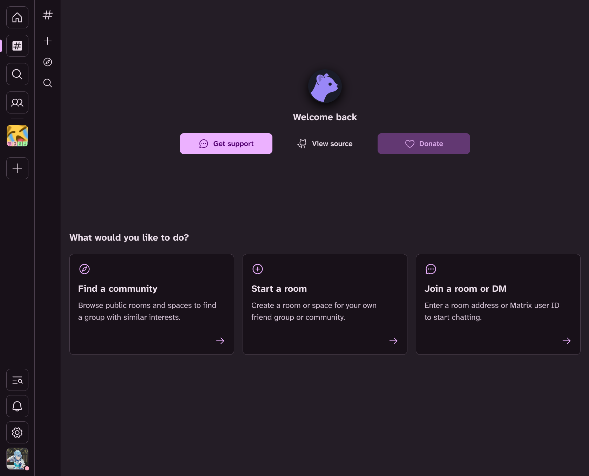
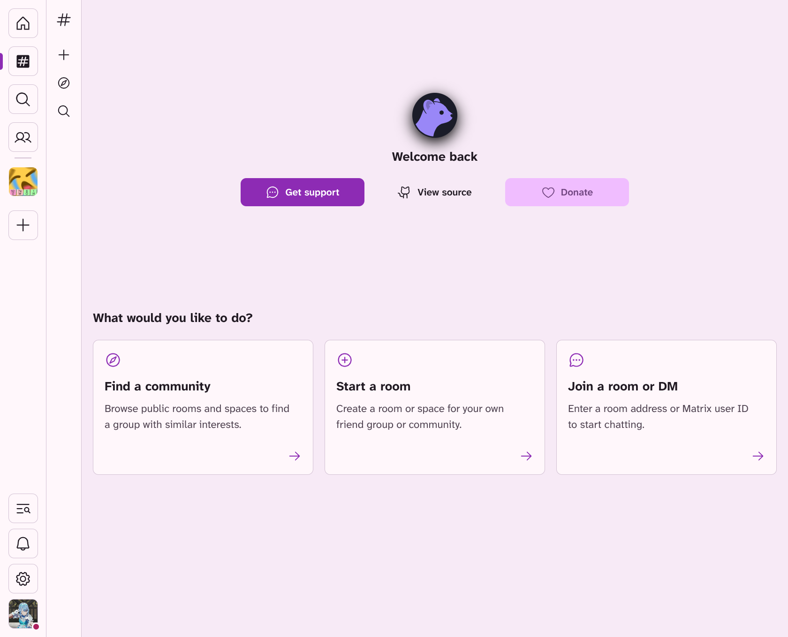

# Sable

Generates a [Sable Client](https://git.sable.moe/SableClient/sable-next) theme with Noctalia's color scheme.

## Setup

1. Enable the sable template in Noctalia Settings. This would generate the `noctalia.sable.css` in `~/.cache/noctalia/sable/` which is the theme file that can be used in Sable.
2. Import the theme file in Sable by going to **Settings -> Appearance -> Themes -> Import File**.
3. Select **Light** mode and apply the theme.

## Screenshots

Below are screenshots for Dark and Light mode under a color palette with a wallpaper as source.

### Dark Mode

### Light Mode

## Notes

The sable client [hot-reloads theme files](https://git.sable.moe/SableClient/sable-next/issues/1440) and any changes to Noctalia's color scheme, Sable would reload the theme with the new colors afterwards. Noctalia's color scheme also changes in Dark and Light mode and the theme would adapt. As such the theme is only in the light mode category of sable and the client's automatic switching of modes is not utilized.
