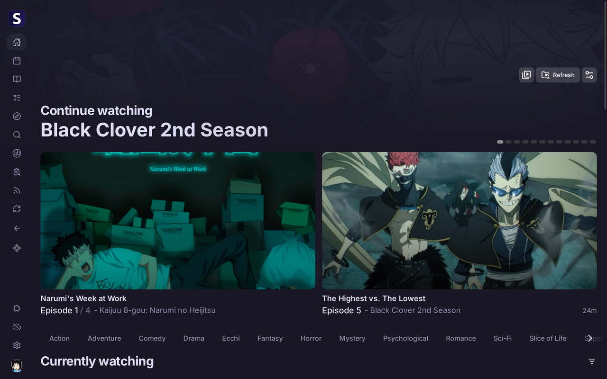
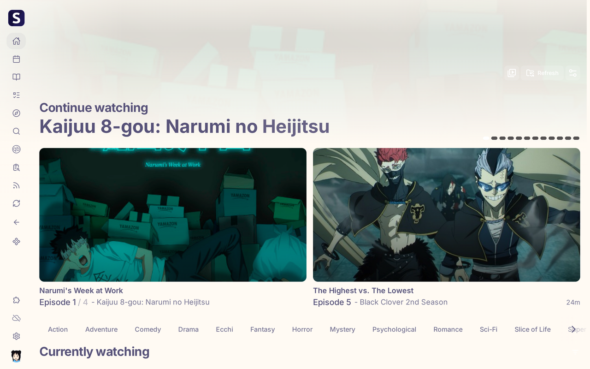

# Seanime

Applies the active Noctalia palette to [Seanime](https://seanime.app): the flat theme variables
and the two Tailwind colour scales its UI is built from (`--color-brand-*`, `--color-gray-*`).





## Prerequisites

- Noctalia with the template engine (Settings → Templates)
- **Seanime 3.10+**
- The **[Noctalia Theme plugin](https://github.com/Below-Z3R0/seanime-noctalia-theme)** installed
  in Seanime, with the file-system permission it asks for granted

The template only writes a file. Without the plugin nothing changes in Seanime.

## Setup

1. Install the plugin in Seanime: Settings → Extensions → Marketplace → *Noctalia Theme* →
   Install, then **Grant** the permission.
2. Enable **Seanime** in **Noctalia Settings → Templates**.

No hook, no script and no post-processing is involved: the template writes one file and the
plugin reads it.

## Output

```
~/.local/state/noctalia/seanime/palette.css
```

A flat list of `--nt-*` custom properties holding Noctalia's Material roles:

```css
--nt-mode: light;
--nt-primary: #d7827e;
--nt-surface: #fffaf3;
--nt-on-surface: #575279;
--nt-surface-container: #f2e9e1;
--nt-on-surface-variant: #797593;
```

`--nt-mode` carries the resolved theme mode (`light` or `dark`) so the plugin keeps Seanime's
colour scheme in step. The file is regenerated on every theme change; it is safe to read, diff or
delete; the plugin goes inert until it comes back.

## How changes take effect

The plugin polls the file every two seconds. Changing the Noctalia theme rewrites it and Seanime
repaints within a couple of seconds, without reloading. Nothing is written outside that path and
no existing configuration is overwritten.

## Seanime in Docker

The plugin reads the file **inside the Seanime container**, so the Noctalia state directory has to
be mounted there:

```yaml
volumes:
  - ${XDG_STATE_HOME:-$HOME/.local/state}/noctalia:/home/seanime/.local/state/noctalia:ro
```

Without it the plugin reports `Not found`.

## Tested against

Seanime 3.10.4 (desktop app and browser client), Noctalia Rosepine palette in light and dark,
including Seanime in Docker with the mount above.
