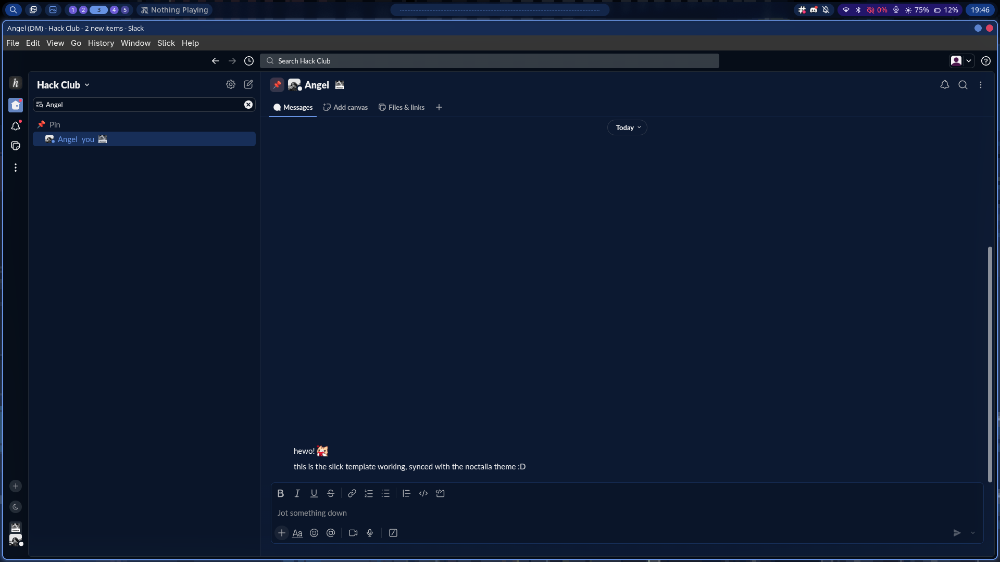

# Slick

---
Applies the Noctalia palette to [Slick](https://github.com/3kh0/slick). Based on Slick's own Catppuccin themes. Supports live-reload.

## Prerequisites

- [Slick](https://github.com/3kh0/slick). Open it once so `settings.json` exists
- `python3`

## Setup

Enable Slick inside Noctalia templates. That's it! It's auto-applied on first run :D

The theme is called "Noctalia", you can find it in Slick's theme picker

## Notes

Slick only reads `custom.css` at startup or when edited through the built-in CSS editor. For live-reload to work, it puts the theme inside `settings.json`, as Slick watches that file :P

It fails if `settings.json` does not exist, so you need to run it at least once before applying the template

This writes the theme to `~/.config/slick/slick/noctalia-theme.json`, and then embeds it in `~/.config/slick/slick/settings.json`

On first run it changes the theme, replacing whichever one you had selected; after that, your choice is kept. Disabling the template resets the theme to the default one
