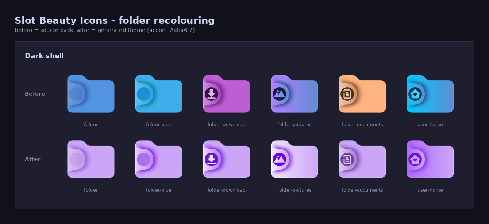
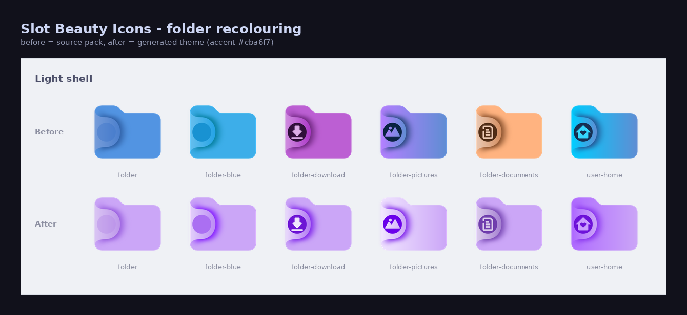

# Slot Beauty Icons — Noctalia Community Template

Tints the folder icons of **Slot Beauty Dark Icons V2** with Noctalia's active
palette, so folders follow your wallpaper instead of staying blue.

The original icon pack is never modified. The template builds a sibling theme,
`Slot-Beauty-Dark-Icons-V-2-Noctalia`, next to it and selects that one.

## Screenshots

Before (the pack as shipped) and after (the generated theme) with the same
palette colour, `#cba6f7`:





## Requirements

The **Slot Beauty Dark Icons V2** pack should be installed in standard icon paths:

```
~/.local/share/icons/Slot-Beauty-Dark-Icons-V-2
```
*(Also automatically detects `~/.icons/`, `/usr/share/icons/`, and `/usr/local/share/icons/`).*

If the pack lives elsewhere, export `SLOT_BEAUTY_SRC` pointing to it before enabling the template.

Tested against the pack by `l4k1` (`Name=Slot-Beauty-Dark-Icons-V-2`).

## What changes

Only the colourful folder icons under `places/` are rewritten:

| Path | Result |
| --- | --- |
| `places/*/folder*.svg` | Recoloured: the folder body lands exactly on `primary` |
| `places/*/user-desktop.svg` | Recoloured: desktop folder icon lands exactly on `primary` |
| `places/*/user-home.svg` | Recoloured: home folder icon lands exactly on `primary` |
| `places/*/folder*-symbolic.svg` | Untouched (monochrome, tinted at runtime) |
| `places/symbolic/*` | Untouched |
| every other file in the pack | Shared with the original through a symlink |

The derived theme stays in sync with the original pack: a rebuild reuses the
existing symlink tree, rewrites only the recoloured folder icons, and removes
entries the pack no longer ships.

## Performance, Security, and Atomicity

- **Secure Atomic File Updates**: Each recoloured folder SVG is written to an unguessable
  temporary file created securely via `tempfile.NamedTemporaryFile` in the same directory,
  and atomically swapped into place via `os.replace`. Icons are never truncated in place,
  so the desktop does not flicker or fall back to default icons mid-write.
- **Fast Synchronization**: A run first fingerprints the source pack, the derived theme,
  and this template's scripts (path, type, size, mtime and link target). When all three
  still match the recorded stamp, the whole sync is skipped, so changing the wallpaper
  only rewrites the folder icons that actually need it.
- **Freshness, not guesswork**: the stamp covers the source pack, the derived theme and
  `recolor.py`/`bodies.tsv`. An icon-pack update, a template edit or a damaged derived
  theme therefore forces a rebuild, while a plain re-run stays free.
- **No stale icons**: after a sync, entries that the pack no longer ships are pruned from
  the derived theme, so a pack update cannot leave renamed or removed icons behind.
- **Writes stay inside the derived theme**: if the pack changes a size from a
  symlink to a real directory, a leftover destination symlink is replaced
  before anything is written, so a recolour can never follow it into the
  original pack.
- **Idempotent Configuration**: GSettings, GTK 3/4 (`settings.ini`), and Qt 5/6 (`qt5ct`/`qt6ct`)
  icon theme settings are only modified when their values actually differ from the target
  theme, avoiding spurious config reloads. Previous values are recorded only after the
  write succeeded, and INI edits are scoped to the exact group and key.

## How the colour is chosen

The palette token is `primary`, taken from the active Noctalia scheme, so the
folders follow wallpaper and theme changes.

Every folder icon is rebuilt around one *anchor* colour — the large, saturated
colour that forms the folder face:

1. The anchor is looked up in `bodies.tsv`, a table precomputed from the
   rendered pixels of this icon pack. It is the same value for every palette,
   because the face of a folder does not change with the theme.
2. The anchor maps exactly onto `primary`.
3. Every other saturated colour keeps its original lightness **offset** from
   the anchor and its saturation **ratio** to it, so gradients, back tabs and
   badges keep their relative tonal structure.
4. Light neutrals (the glyph lines, e.g. `#eff0f1`) stay light and legible.
   Dark neutrals (shadows, base plates) stay dark with a faint tint.
5. Icons without any saturated colour — the small monochrome line-art folders
   at 16/22/24 px — are left exactly as they are, so GTK and Qt keep tinting
   them at runtime.

If an icon is missing from `bodies.tsv` (a different revision of the pack),
the anchor is detected from the file itself instead of skipping the icon.

`bodies.tsv` is regenerated with:

```sh
python3 gen_bodies.py \
  ~/.local/share/icons/Slot-Beauty-Dark-Icons-V-2/places bodies.tsv
```

`gen_bodies.py` needs `rsvg-convert`; it is only needed when the pack changes,
never when the template runs.

## Side effects

Enabling the template:

- creates `~/.local/share/icons/Slot-Beauty-Dark-Icons-V-2-Noctalia`;
- sets the GSettings icon theme (`org.gnome.desktop.interface icon-theme`);
- sets the GTK 3/4 icon theme (`gtk-icon-theme-name`);
- sets the qt5ct/qt6ct icon theme (`icon_theme`) if the respective config file exists;
- records previous values and unset state in `~/.config/noctalia/slot-beauty-icons.state`.

Disabling the template (`undo_hook`):

- restores each recorded setting to its exact previous value;
- removes any setting that was originally unset;
- removes a `settings.ini` that the template created, but keeps it if you have added
  settings of your own since;
- deletes the state file only once every restore succeeded — if one fails, the state is
  kept so `undo` can simply be run again;
- leaves the derived theme directory on disk so re-enabling is instant.

## Notes

- The template is safe to re-run: it rebuilds only when the colour, the icon pack or the
  template itself changed, and the rebuild is idempotent.
- The original pack stays untouched at all times.
