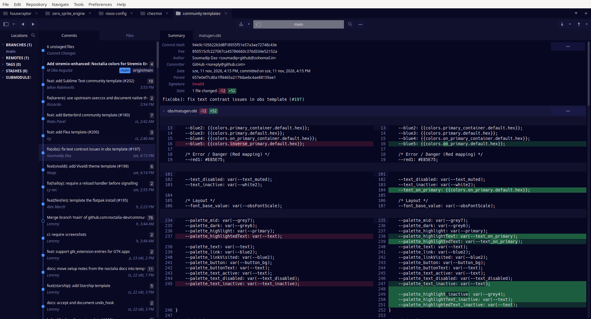
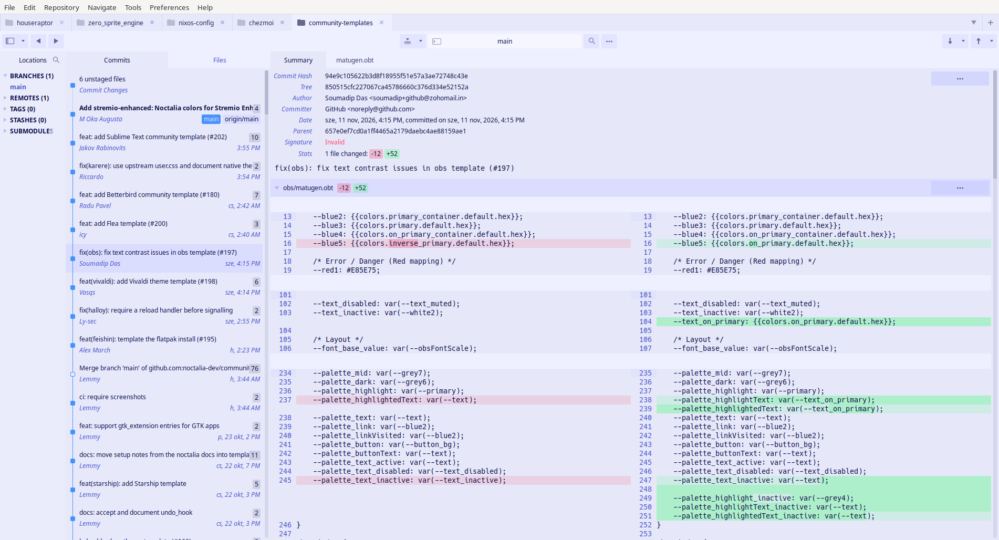
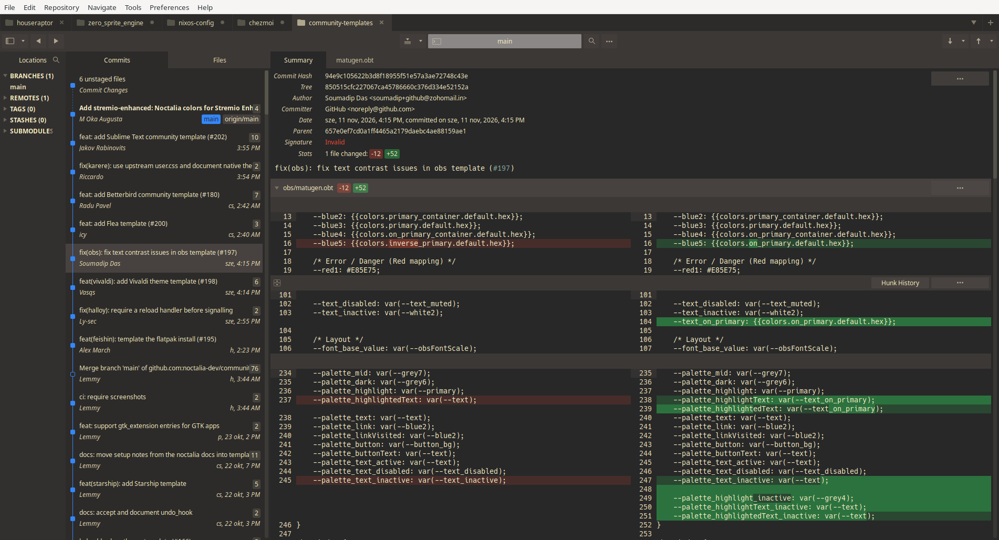
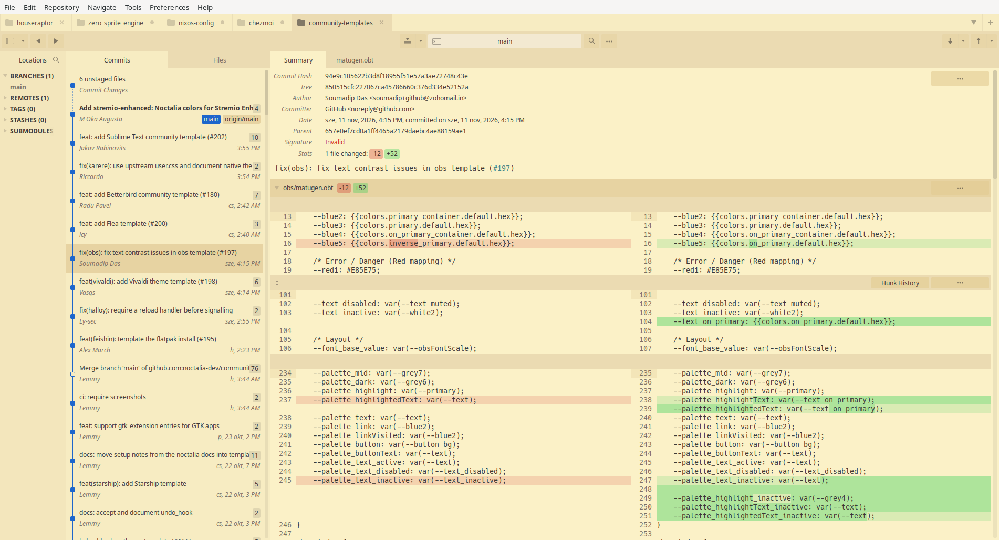

# Sublime Merge

Adds a Noctalia **UI theme** (header, side bar, commit list and graph, tabs, buttons, dialogs, quick panel,
branch and tag labels, file headers) and a Noctalia **color scheme** for every text view (diffs, the commit
message box, file and blame views, git output, input fields) to Sublime Merge.

Enable **Sublime Merge** in **Noctalia Settings -> Templates**. The template only renders when
`~/.config/sublime-merge` exists. Dark and light mode are both supported: the files are re-rendered on every
Noctalia theme or mode change.

## Prerequisites

A **licensed** copy of Sublime Merge. Unlicensed (evaluation) Merge is limited to its stock light theme and
ignores custom themes, so neither the theme nor the per-view color schemes below take effect without a
license.

## Setup

Merge's theme picker only offers its built-in Light and Dark themes, so select the theme once by editing
`~/.config/sublime-merge/Packages/User/Preferences.sublime-settings` (**Preferences -> Edit Settings…**):

```json
{
    "theme": "Noctalia.sublime-theme"
}
```

No color scheme setting is needed: while the Noctalia theme is selected, Merge reads the per-view settings
files below and uses the Noctalia color scheme everywhere.

Sublime Merge with the Noctalia dark theme:


Sublime Merge with the Noctalia light theme:


Sublime Merge with the Gruvbox dark theme:


Sublime Merge with the Gruvbox light theme:


## Generated files

All are written to `~/.config/sublime-merge/Packages/User/`:

- `Noctalia.sublime-theme` — extends the stock `Merge.sublime-theme` and recolors it through its variables
- `Noctalia.sublime-color-scheme` — syntax highlighting and diff colors
- `Diff - Noctalia.sublime-settings`, `Commit Message - Noctalia.sublime-settings`,
  `File Mode - Noctalia.sublime-settings`, `Git Output - Noctalia.sublime-settings` and
  `Widget - Noctalia.sublime-settings` — route each view to the Noctalia color scheme

Diff additions, deletions and the commit graph lanes need fixed hues (green for added, red for removed, six
distinct lane colors), which Noctalia's color tokens do not guarantee: apart from `error`, a token can be any
hue the palette gives it. These hues are derived from the palette's `error` color with only the hue changed.
Where such a hue is drawn as text or as a line (graph lanes, branch labels, signature status), Sublime's
`min-contrast()` adjusts its lightness to stay readable on the panel behind it, in dark and light mode alike.
The diff background tints use the hue unchanged.

No hooks are used; the template only writes the files listed here and never touches your preferences.
Disabling the template stops updates — remove the generated files and the `theme` setting to fully revert.
