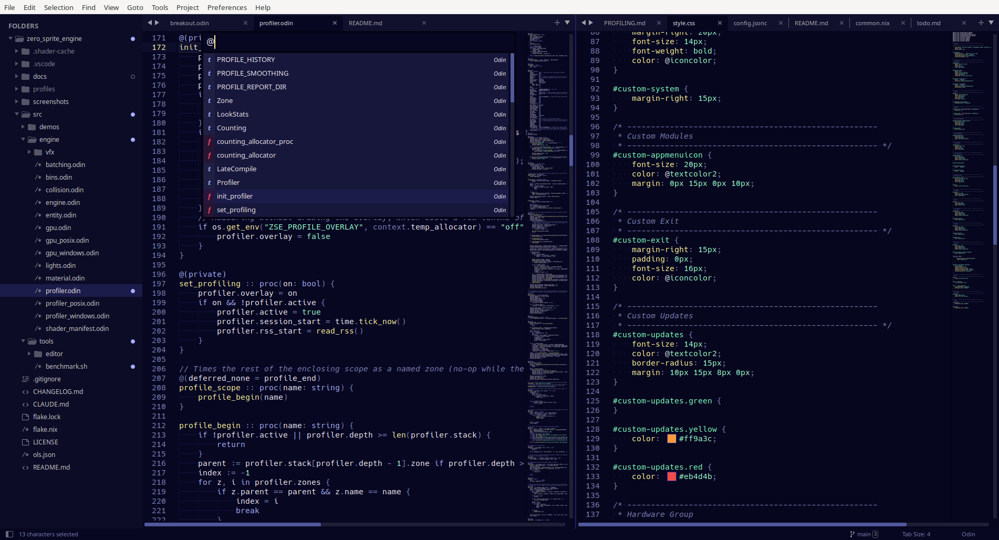
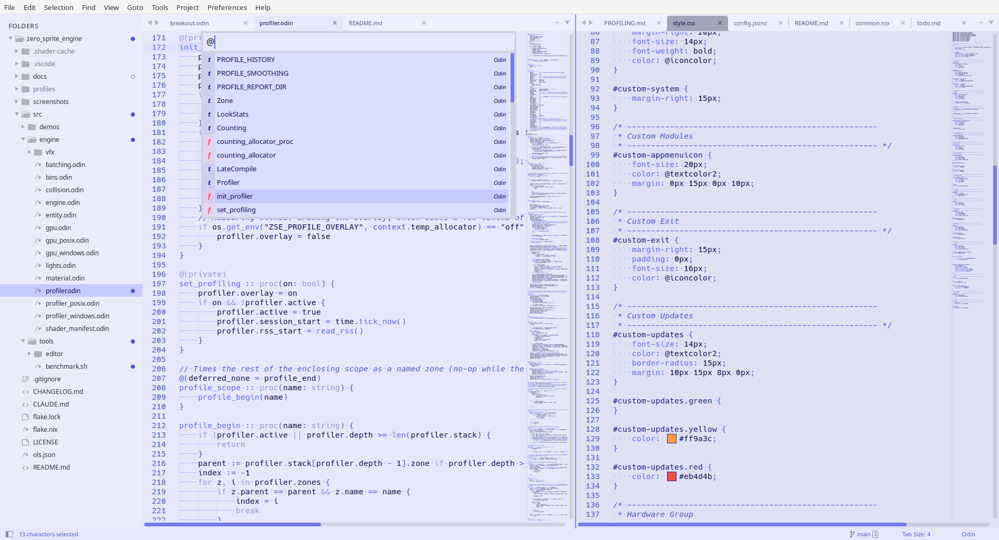
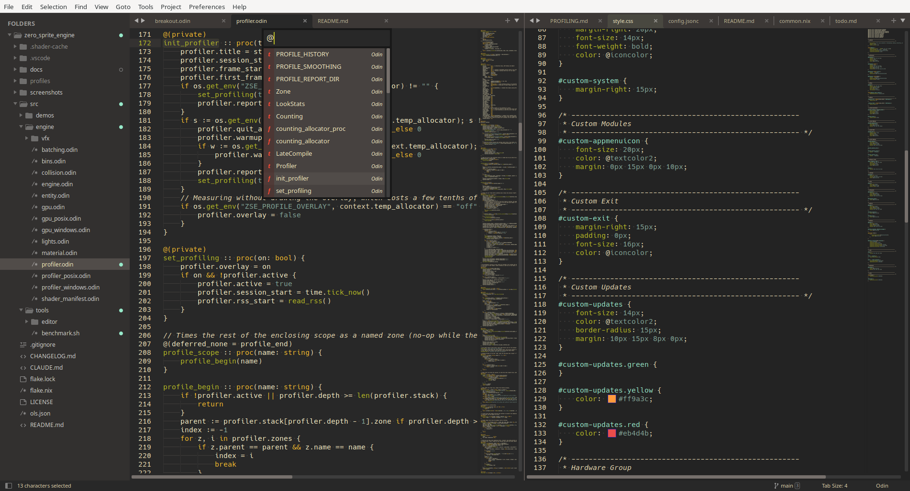
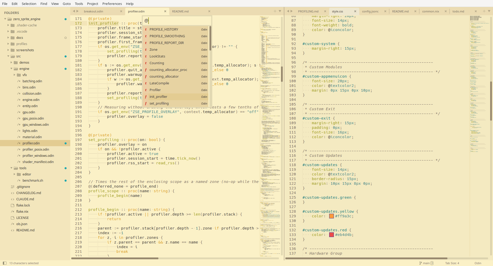
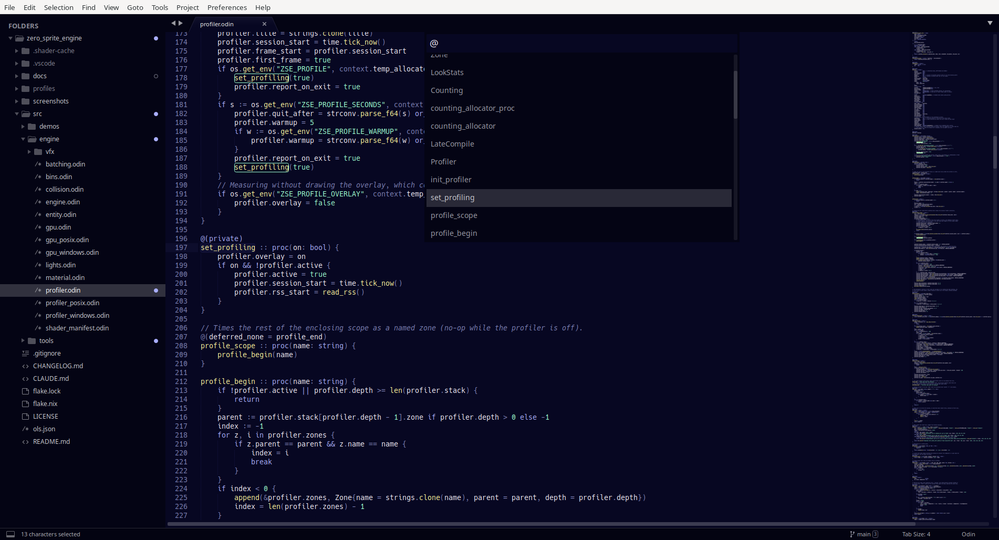
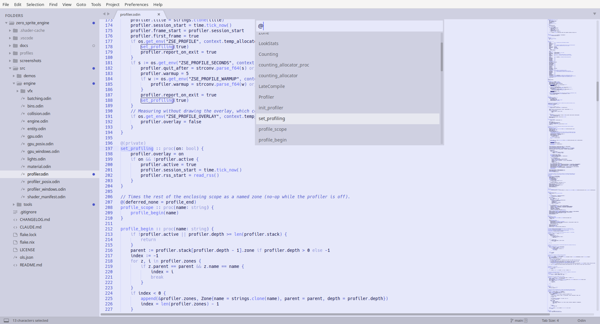

# Sublime Text

Adds a Noctalia **color scheme** (syntax highlighting, selections, gutter, diff markers) for Sublime Text 3
and Sublime Text 4, plus a **UI theme** (sidebar, tabs, status bar, panels, autocomplete, tooltips) for
Sublime Text 4.

Enable **Sublime Text** in **Noctalia Settings -> Templates**. Entries only render for versions that are
installed (detected via the config directory), and both dark and light mode are supported: the files are
re-rendered on every Noctalia theme or mode change, and Sublime Text reloads them live.

## Sublime Text 4

Two files are written under `~/.config/sublime-text/Packages/`:

- `User/Noctalia.sublime-color-scheme`
- `Theme - Default/Noctalia.sublime-theme` — a standalone theme extending the bundled **Adaptive** theme

The theme goes into a `Theme - Default` folder rather than `User` on purpose. Sublime Text looks up the side
bar's file-type icons relative to the active theme file, so a theme stored in `User` loses every file icon.
A loose `Theme - Default` folder is overlaid on the bundled package of the same name: the template adds
this one file there (the folder is created if missing) and does not replace any stock theme.

Select both once via the command palette (`UI: Select Color Scheme`, `UI: Select Theme`) or in your
`Preferences.sublime-settings`:

```json
{
    "theme": "Noctalia.sublime-theme",
    "color_scheme": "Noctalia.sublime-color-scheme"
}
```

Set `color_scheme` to the Noctalia file directly (not `"auto"`); Noctalia itself swaps the colors in place
when your system switches between dark and light.

ST4 with the Noctalia dark theme:


ST4 with the Noctalia light theme:


ST3 with the Gruvbox dark theme:


ST3 with the Gruvbox light theme:


## Sublime Text 3

Requires Sublime Text 3.1 (build 3170) or newer. Written to `~/.config/sublime-text-3/Packages/User/`:

- `Noctalia.sublime-color-scheme`

ST3 gets the color scheme only: its theme engine has no `extends`, so a Noctalia UI theme would have to
override the bundled Adaptive theme, which this template deliberately avoids. For a UI that follows the
scheme, select the **Adaptive** theme, which derives its colors from the active color scheme:

```json
{
    "theme": "Adaptive.sublime-theme",
    "color_scheme": "Noctalia.sublime-color-scheme"
}
```

No hooks are used; the template only writes the files listed here and never touches your preferences.
Disabling the template stops updates — remove the generated files (and the `Theme - Default` folder, if
this template created it and it is otherwise empty) and your `theme` / `color_scheme` settings to fully
revert.

ST3 with the Noctalia dark theme:


ST3 with the Noctalia light theme:

