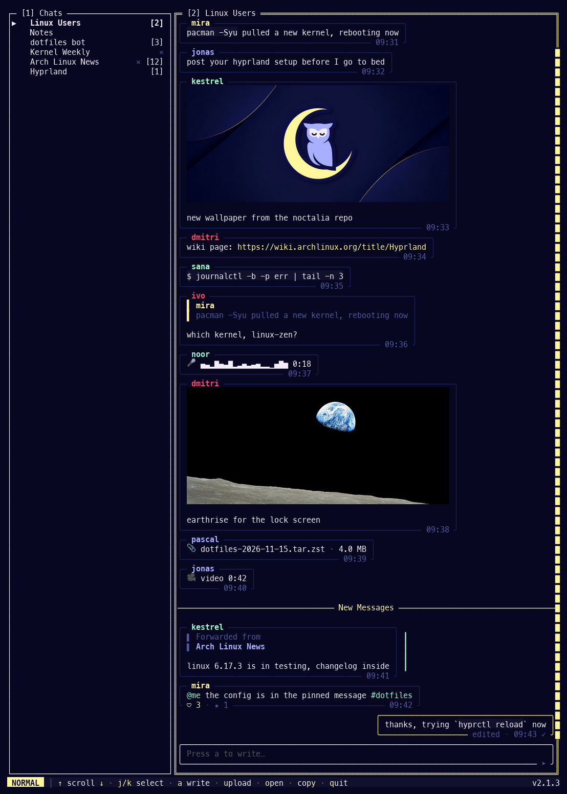
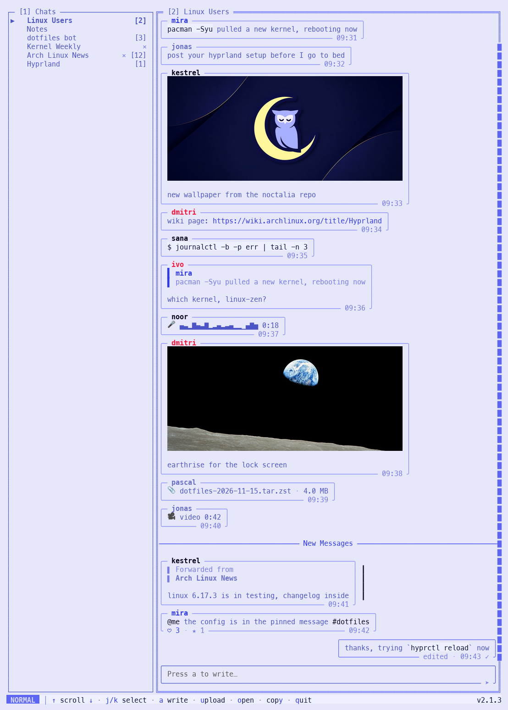
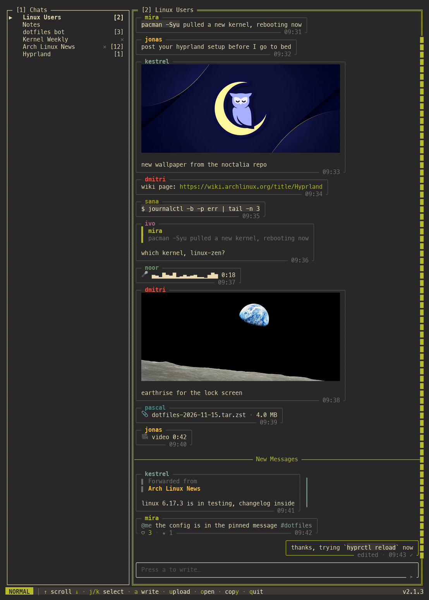
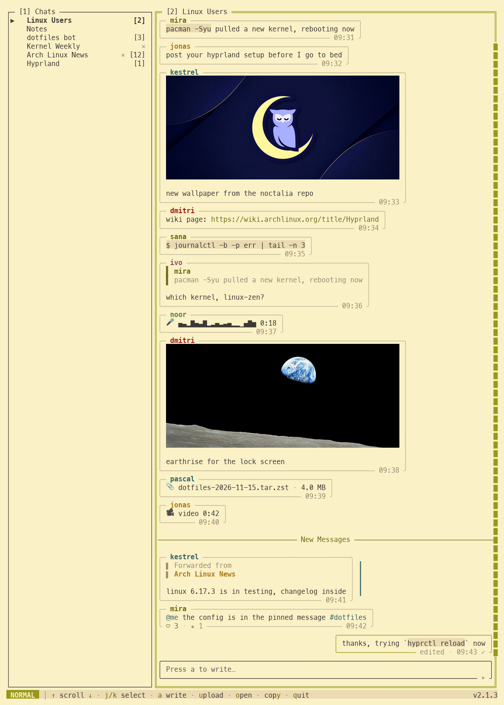
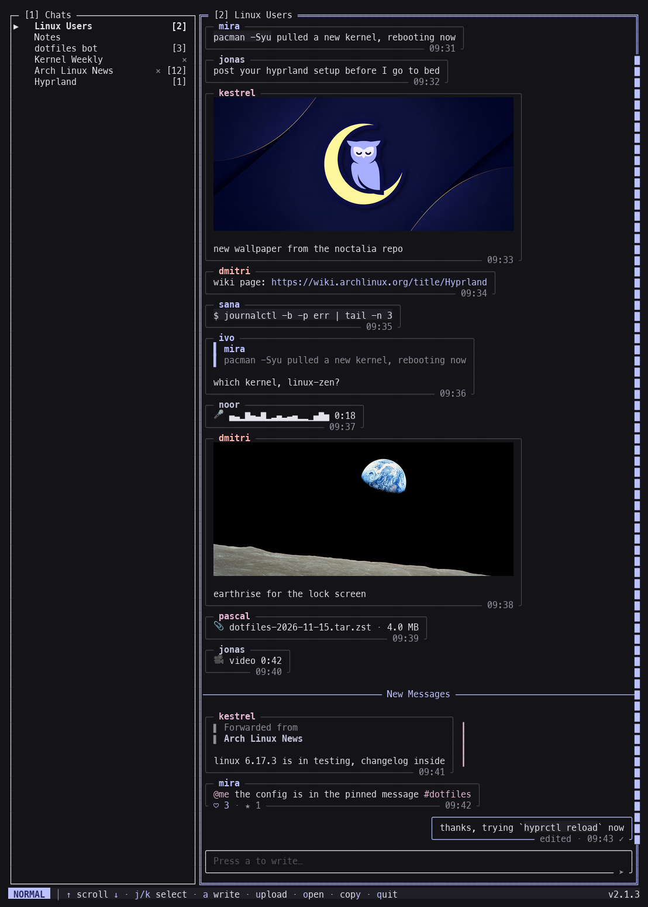
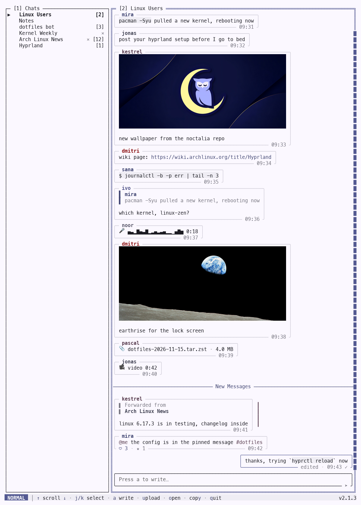

# tele

Themes [tele](https://github.com/sorokin-vladimir/tele), a terminal Telegram client, with the active Noctalia palette.

## What it themes

Renders all 62 tele theme tokens (surfaces, text, accents, status colors, borders, sender names, markup and the logo gradient) from the Noctalia Material palette. `background` and `text` are `none`, so the terminal's own background and foreground show through. Colors are picked against Noctalia's terminal background, so use a Noctalia-themed terminal in the same mode. In light mode each accent color is lowered by 10 points of lightness to gain contrast against a light background.

## Prerequisites

tele 2.1.3, with `~/.config/tele` present. Noctalia skips the template when that directory is missing.

## Setup

Enable **tele** in **Noctalia Settings -> Templates**. Noctalia writes `~/.config/tele/themes/noctalia.yml`. tele reads `~/.config/tele` regardless of `XDG_CONFIG_HOME`, so the template writes there too. Select the theme once in `~/.config/tele/config.yml`:

```yaml
ui:
  theme:
    dark: noctalia
    light: noctalia
```

`tele theme check` lists 62 tokens from `noctalia` in each slot. The template has no hook and does not edit your tele config.

## How changes take effect

Noctalia rewrites the file on every palette change, and tele reads it at startup. To apply a new palette without restarting, bind `reload_config` and press the key:

```yaml
keybindings:
  global:
    reload_config: ctrl+t
```

## Screenshots

The screenshots show tele 2.1.3 rendering a sample Linux chat with the generated theme. tele draws photos through the Kitty graphics protocol, so the two pictures are placed where tele reserves their cells. They are the Noctalia wallpaper from noctalia-dev/noctalia (MIT) and NASA's Apollo 8 Earthrise photo (public domain).

Noctalia dark palette:


Noctalia light palette:


Gruvbox dark palette:


Gruvbox light palette:


Palette generated from the Noctalia wallpaper, dark:


Palette generated from the Noctalia wallpaper, light:

