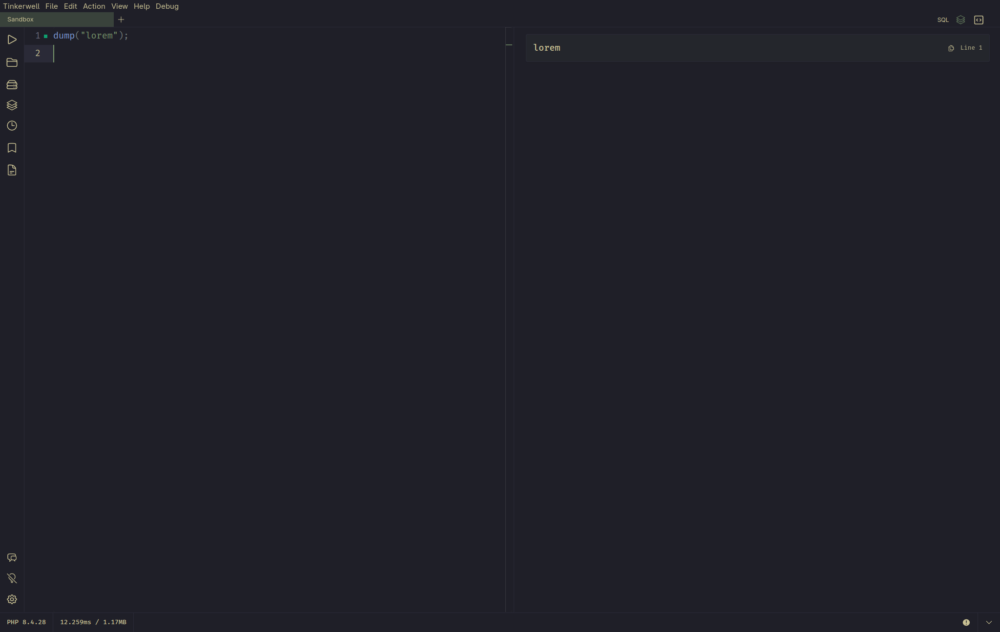
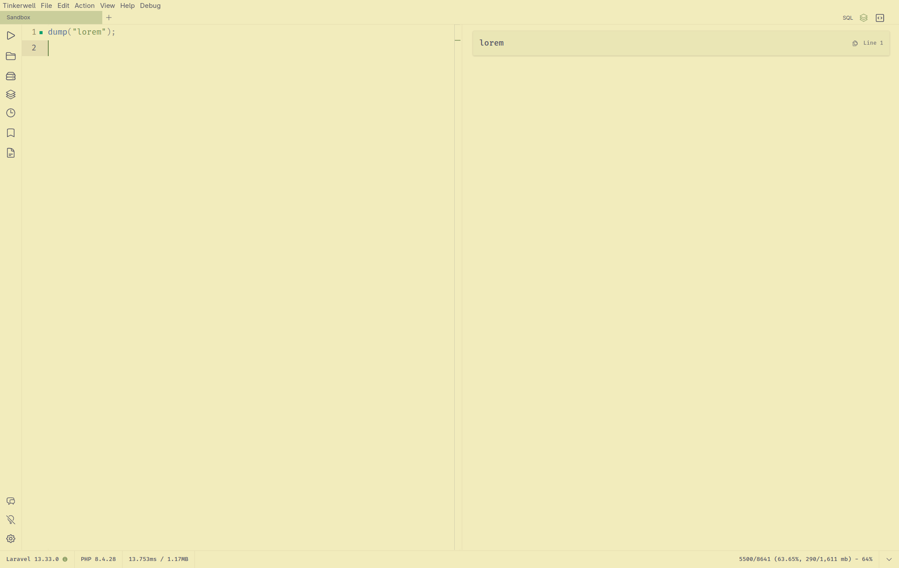

# Tinkerwell

Themes [Tinkerwell](https://tinkerwell.app)'s editor, output pane and buttons
with the Noctalia palette, in dark and light mode.

Tested with Tinkerwell 5.17.4 on Linux.

## Screenshots

## Setup

1. Enable the template. It writes a custom theme to
   `~/.config/tinkerwell/themes/noctalia.json`, the folder Tinkerwell reads
   custom themes from. This is a different folder from Tinkerwell's own
   `~/.config/Tinkerwell` settings directory, which only has to exist (that
   is, Tinkerwell has been run once) for the template to be applied.
2. In Tinkerwell, open the theme settings, press the refresh button next to
   the theme list and select `noctalia`.

## Applying changes

Tinkerwell does not watch its themes folder. After Noctalia's palette or mode
changes, press the theme list's refresh button again or restart Tinkerwell
to pick up the new colors.

Noctalia rewrites the same file for dark and light mode, so you don't
need Tinkerwell's "Sync / Match system" appearance mode: keep `noctalia`
selected as a single fixed theme.

No hooks run, and nothing in Tinkerwell's own settings is modified.
