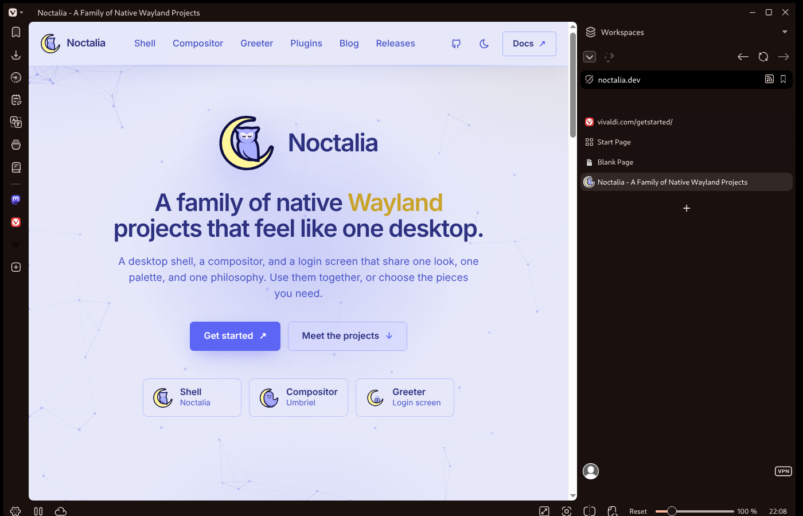
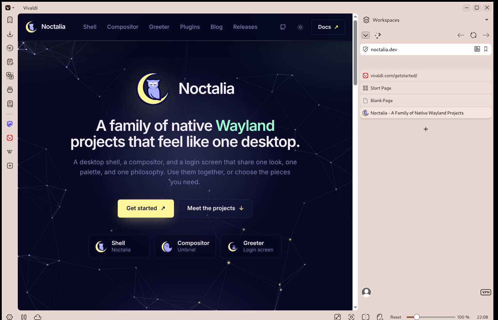

# Vivaldi

Keeps [Vivaldi](https://vivaldi.com/) in sync with the Noctalia palette by
installing a native Vivaldi user theme.





## What it themes

Noctalia renders the palette into an official Vivaldi theme (`settings.json`).
The theme colours the browser chrome: window frame, tab bar, address bar,
panels, toolbars, menus and the Start Page surfaces. The palette primary is used
for the accent, so focus rings, selected tabs and highlights follow Noctalia.

Web page content is not themed.

## Requirements

- Vivaldi 8.x. Tested against **Vivaldi 8.2.4133.96 stable** on Linux.
- `python3` (used to edit Vivaldi's JSON preferences atomically).
- Noctalia **5.4.1** (tested version).

No extension, CSS modifications, or Vivaldi experiments are needed.

## Setup

1. Enable **Vivaldi** in Noctalia under *Settings → Templates → Community*, or
   add it to `config.toml`:

   ```toml
   [theme.templates]
   community_ids = ["vivaldi"]
   ```

2. **Quit Vivaldi completely.** Vivaldi reads `vivaldi.themes` from each
   profile's `Preferences` at startup and keeps the file in memory while it
   runs, so the hook will not write while Vivaldi is open.

3. Apply a Noctalia theme (change the wallpaper/palette or re-apply the current
   one). Start Vivaldi. The **Noctalia** theme is selected in
   *Settings → Themes → Library*.

Applying again while Vivaldi is running is safe: the hook only regenerates the
importable ZIP and prints a warning. Quit Vivaldi and re-apply the Noctalia
theme to write it to the profiles.

## How it works

`apply.sh` finds the native stable/snapshot profiles and both Flatpak variants:

- `$XDG_CONFIG_HOME/vivaldi`
- `$XDG_CONFIG_HOME/vivaldi-snapshot`
- `~/.var/app/com.vivaldi.Vivaldi/config/vivaldi`
- `~/.var/app/com.vivaldi.Vivaldi.Snapshot/config/vivaldi-snapshot`

It updates `Default` and every `Profile *` inside each one. For each profile it:

- adds or replaces a user theme with the fixed id
  `c9d015eb-e046-45f4-8e7a-d6118a07696b`, so palette changes update the same
  entry instead of creating duplicates;
- selects that theme in `vivaldi.themes.current`;
- bumps the theme `version`. Vivaldi caches an active theme by id and version,
  so changing colours without bumping the version is ignored on the next start;
- snapshots the original `Preferences` once before the first edit.

The rendered theme is also packed for manual import:

| Path | Purpose |
| --- | --- |
| `$XDG_CACHE_HOME/noctalia/vivaldi/settings.json` | Rendered Vivaldi theme |
| `$XDG_DATA_HOME/noctalia/vivaldi/Noctalia.zip` | Importable theme archive |
| `$XDG_DATA_HOME/noctalia/vivaldi/backups/<profile-hash>/Preferences.original` | Original profile snapshot |
| `$XDG_STATE_HOME/noctalia/vivaldi/<profile-hash>.json` | Previous theme selection |
| `$XDG_STATE_HOME/noctalia/vivaldi/version` | Monotonic theme version counter |

## Manual import while Vivaldi is running

If you do not want to quit Vivaldi, import the generated ZIP:

1. *Settings → Themes → Library → Open Theme* (or **Import Theme…**).
2. Choose `~/.local/share/noctalia/vivaldi/Noctalia.zip`
   (`$XDG_DATA_HOME/noctalia/vivaldi/Noctalia.zip`).

This is a snapshot, not a live sync. Re-import after each palette change, or
quit Vivaldi and let the hook write the profiles for the next start.

## Switching palettes and restoring

Vivaldi must be stopped for palette updates and for undo. If Vivaldi is running,
the hook leaves every `Preferences` untouched and exits with a warning so
Noctalia can surface the message in Settings.

Undo removes the Noctalia user theme and restores the previously selected theme.
If no previous selection was recorded, it falls back to Vivaldi's built-in
`Vivaldi2` or `Vivaldi1` theme. The original `Preferences` snapshot remains under
the backup path above if you need to recover it manually.

## Limits

- The theme is applied only at Vivaldi startup; it cannot be changed live from
  outside the browser.
- Web content, `vivaldi://` pages and extension pages are not themed.
- Vivaldi does not support Chromium's `BrowserThemeColor` policy, which is why
  this template does not reuse the generic Chromium theme.
- Custom CSS UI modifications still need Vivaldi's own *Allow CSS Modifications*
  experiment and are outside this template.
