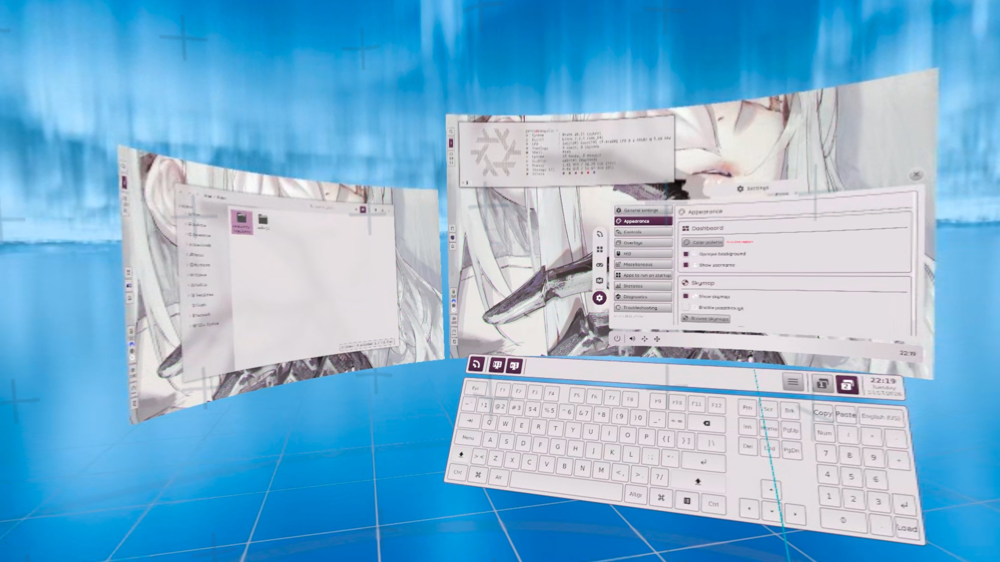

# WayVR

Gives a theme to [WayVR](https://github.com/wayvr-org/wayvr) to have it in the same colors as Noctalia.



## Setup

In WayVR, open the Dashboard either on the keyboard or wrist, and then **Settings → Appearance → Color Palette** and then **noctalia** once.

## Output

The template writes directly to:

```text
~/.config/wayvr/palettes/noctalia.json
```
